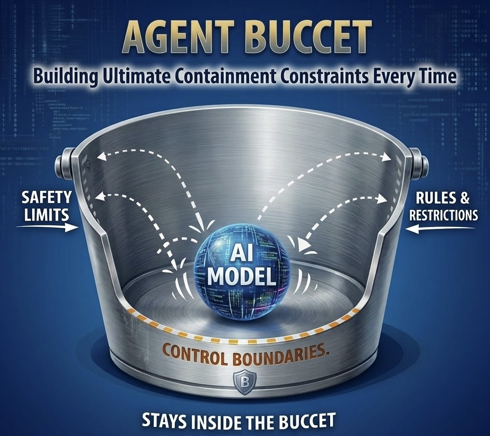

# Agent Buccet

Action-boundary law for AI agents.

Building Ultimate Containment Constraints Every Time.



Agent Buccet is not another agent framework, wrapper, or prompt strategy.

It is a different layer in the stack: a law-bound control body that sits at the action boundary where agent behavior becomes real.

Agents can propose. They cannot authorize.

Buccet decides:

- what can happen
- what must stop
- what needs approval
- what becomes standing user law
- what gets recorded in the ledger

## Why This Changes The Stack

Most agent tooling lives above the consequence boundary:

- prompts try to steer behavior
- frameworks coordinate tools
- model providers improve or regress
- wrappers shape developer ergonomics

Buccet lives below that layer, at the point where an agent tries to touch the world.

That is the shift:

- the model can change
- the framework can change
- the workflow can change
- the action boundary does not change

If you control the action boundary, you control every agent stack above it on the same machine.

## Plain-English Map

- `UPL` = User Path Laws, the live rulebook built from what the user allows and forbids
- `agent` = the moving part between the live rulebook and the outside world; it proposes outward motion, then returns to the same boundary for judgment
- `acceptance` = the allow side of that rulebook
- `denial` = the stop side of that rulebook
- `tracks` = the post-law rails and walls snapped from the live rulebook so motion stays finite after law is decided
- `paths` = named workflows that stay inside the rulebook
- `path sources` = files and notes attached to a path to add context, not permission
- `ledger` = the audit trail of what was proposed, allowed, denied, approved, and executed

In Buccet, that live rulebook becomes the standing skill surface.
There is no separate recursive skill registry above it.

Agent Buccet provides the *brakes* and runtime enforcement against AI failure modes. These failures are systematically mapped as the "spec" in the [AI Failure Periodic Table](https://github.com/lml-layer-system/ai-failure-periodic-table).

## What You Get

- one live rulebook built from allowed rules and blocked rules
- one terminal where you can run, approve, deny, inspect, and audit
- reusable workflows for repeatable safe work
- attached context for each workflow without widening permission
- interactive and headless modes on the same control body
- one repo-owned Rust/WASM substrate that carries portable bounded runtime behavior across machines without Docker-scale bloat
- durable audit trail from first proposal to final consequence

## What Actually Runs

The repo is larger than the hot runtime on purpose.

Agent Buccet keeps the full readable body in-repo:

- docs
- proofs
- doctrine
- rendered packs
- source and archive material

But the live snapped runtime executes through a smaller surface:

- the active law-body manifest
- the active law-body `projected-laws.json`
- the live `user-path-ledger.json`
- the native `physwrap` lane
- the native `deep-intercept` lane
- the vendored Rust/WASM substrate

That is the operational distinction:

- `run-surface` = the snapped body the machine actually executes
- `read-surface` = the larger repo body people can inspect, study, and verify

Buccet does not require the whole readable body to be the hot execution path.
It keeps the whole body available while pinning runtime consequence to the snapped system.

## Fast Start

The short path is:

```bash
git clone https://github.com/lml-layer-system/agent-buccet
cd agent-buccet
sh scripts/install-agent-buccet.sh
buccet init
buccet console
```

That is the normal operator bring-up.
Install the runtime, initialize the machine, then open the Buccet operator cockpit.

Hosted install coming soon.

`buccet console` is the point where your terminal becomes Agent Buccet's working control surface.

## MCP Server

`buccet mcp` starts an MCP (Model Context Protocol) server over stdio.

Wire it into any MCP host — Claude Desktop, Cursor, or any compatible client:

```json
{
  "mcpServers": {
    "buccet": {
      "command": "buccet",
      "args": ["mcp"]
    }
  }
}
```

Every tool call from the host enters the same enforcement chain — same UPL, same bodyguard, same ledger. MCP is transport only. Adding a new host does not change what Buccet allows.

See [MCP Server](docs/agent-boundary/MCP_SERVER.md) for setup, available tools, and how to authorize actions via UPL.

## Portable Transport

Buccet can now package a bounded workload and move it between machines through its own transport surface.

Pack a portable app tree:

```bash
buccet transport pack ./demo --output demo.buccet.tgz -- /bin/demo
```

Import it somewhere else:

```bash
buccet transport import demo.buccet.tgz --into ./demo-portable
```

Run it from the packaged root:

```bash
buccet transport run demo.buccet.tgz
```

That flow sits on top of the Buccet substrate portability chain:

- `applyIsolation`
- `persistState`
- `enterEnvironment`

So the user-facing transport story is now inside Buccet too, not only in the lower Rust/WASM substrate.

The entry command is resolved from inside the packaged rootfs, not from host `PATH`.

## What Boundaries Buccet Actually Governs

Buccet is not one vague safety layer.
It governs several explicit boundaries, each with a different job.

- action boundary: every real-world action proposal is intercepted before it lands
- chat boundary: model output is governed before it is emitted as visible chat or agent response
- input admission boundary: hostile inbound force is screened before tokenization, inference, or API spend
- motion governor: runaway outbound behavior is slowed, frozen, or stopped by session force limits
- payload physics boundary: even approved processes stay inside hard ceilings for time, memory, process count, file growth, and I/O shape
- approval boundary: the runtime only returns `ALLOW`, `DENY`, or `REQUIRE_APPROVAL`
- ledger boundary: every crossing is recorded from first input pressure to final consequence

So the boundaries are not implied.
They are named, enforced, and auditable.

## How Buccet Runs In Practice

Buccet has two operating modes, but they are the same boundary body underneath.

### Interactive mode

Use `buccet console` when you want a human at the boundary in real time.

- proposals freeze at the boundary
- the human can approve, deny, or turn repeated decisions into standing law
- approved judgment can be compiled into the live UPL so the same decision does not need to be re-made forever

### 24/7 headless mode

Use headless mode when you want the same governed system to run continuously without a human sitting at Terminal 2.

- the runtime follows standing human law already recorded in the UPL
- the same boundaries, rails, walls, ledger, and governor still apply
- unclear, unlawful, or out-of-lane motion still fails closed instead of silently self-authorizing

Autonomous mode does not mean "the human is gone."
It means the human already authored or approved the law, and that standing UPL becomes the approval surface in the loop now.

In that sense, the UPL becomes the operational form of the human in the loop:
stored human judgment the system follows at runtime.

## Install

```bash
git clone https://github.com/lml-layer-system/agent-buccet
cd agent-buccet
sh scripts/install-agent-buccet.sh
```

Hosted install coming soon.

Then:

```bash
buccet init
buccet console
```

`buccet init` now does the fast machine bring-up and will arm the deepest packaged enforcement path immediately when the native layer is already present.
`buccet console` opens the unified operator cockpit where approval, denial, tracks, swarm state, and audit all live together.

If you need to re-arm or recover the native enforcement path manually:

```bash
buccet hook start
```

## First Run

Open scope and run one guarded command:

```bash
buccet scope add .
buccet run -- /bin/echo protected
buccet status
buccet logs
```

If you want the shortest operator map:

```bash
buccet where
```

If you want the full machine posture check:

```bash
buccet doctor --strict
```

## Where Things Go

Allowed rules:

```text
~/.buccet/upl-docs/acceptance
```

Blocked rules:

```text
~/.buccet/upl-docs/denial
```

Path sources:

```bash
buccet path sources add <path-name> <file...> [--domain <domain>]
```

Paths:

```bash
buccet path run <path-name> [--request <text>] [--steps <n>|--all]
buccet path watch <path-name|formation-id> [--follow]
```

If users forget `buccet upl sync`, Buccet now auto-syncs changed rule docs before runtime surfaces like `buccet console`, `buccet run`, `buccet hook run`, and `buccet path run`.

## What "Agent" Means Here

In Buccet, an agent is not the law.
It is the moving interval between the law and the outside world.

It leaves the live rulebook to search, speak, call tools, touch files, send network traffic, or coordinate work.
Then it returns to the same boundary for judgment, recording, and further motion.

That means the agent is always downstream of the UPL, not above it.
It can propose motion.
It cannot define the laws of its own existence.

## How Buccet Cuts Recursive Loops At The Source

Buccet does not let approval reopen infinite agency.

Once standing law exists, Buccet snaps that live UPL into finite tracks on the two post-law continuation surfaces:

- tool and action motion
- chat and output motion

Acceptance becomes motion rails.
Denial becomes motion walls.
They live in one compiled runtime field, but they do not do the same job.

That is how recursive drift gets cut at the source:

- the model does not return to open-ended general agency after law is set
- lawful motion stays inside the snapped corridor
- denied motion is not a usable lane for the agent
- if motion leaves the approved corridor, Buccet surfaces the drift instead of silently widening the world

The denial side is not a suggestion and not a second menu of options.
For the running agent, those are physically unavailable tracks.
It does not get the denial side as a visible route to travel.
It operates on lawful structure only.
UPL Traffic is the controller that keeps yes on yes and no on no:
- acceptance rails stay open in motion
- denial walls stay closed in motion

If motion tries to leave the lawful rail, Buccet does not hand the agent a no-side lane.
It holds the boundary, surfaces the drift, and fails closed instead of widening the world.

Paths cut recursion at the orchestration layer in the same spirit.
They keep higher-order work forward-only, finite, and stage-bound instead of recursively replanning forever.

## Why Swarms Do Not Change The Boundary

Buccet does not need a second control system for swarms.

If many protected processes or agents hit the same unresolved target:

- the hooks still freeze and hold
- one Buccet brain groups matching requests together
- one lawful approval or denial resolves that whole group
- the same law body, rails, walls, scope truth, and ledger still govern the outcome

Swarm scale does not create a new exception path.
It is still one boundary system, not a special swarm override.

## How Skills And Sources Enter Buccet

There are two different intake paths, and they do different jobs.

### 1. External skills and workflows become rules

If you find a skill, template, or workflow in a source catalog, you bring the raw material into Buccet's rule layer.

Example sources:

- `SkillsMP`
- `AITmpl Skills`
- `SkillHub`
- `AgentSkills`

Fast openers:

```bash
buccet upl sources --open skillsmp
buccet upl sources --open aitmpl
buccet upl sources --open skillhub
buccet upl sources --open agentskills
```

Then the flow is:

1. pick the skill or workflow you want
2. copy the real source material
3. paste it into the allow side or the block side
4. sync it
5. Buccet compiles it into the live rulebook

That copied source material can be:

- raw skill text
- `SKILL.md`
- `README.md`
- extracted package markdown
- normal workflow descriptions

So the user does not need to hand-write law just to bring a skill into the system.
Buccet parses the source material into standing rules.

### 2. Path sources add context, not permission

Path sources are different.

They do not decide what the agent is allowed to do.
They only enrich a named workflow with domain context.

Example:

- the rulebook may allow research work inside a project
- a path source can attach books, notes, specs, or reference files to the `research` path
- that makes the path smarter without making it more powerful

Add path sources with:

```bash
buccet path sources add <path-name> <file...> [--domain <domain>]
```

So the split is:

- rules decide permission
- path sources add context
- denial still overrides acceptance
- the ledger records what happened

## How Buccet Handles Flooding And Cost

Buccet does not wait for an agent to wake up, think, and spend money before trying to defend itself.

Inbound pressure is governed first.
The input admission boundary evaluates velocity, density, mass, and weak provenance.
If a source looks hostile or starts a DDoS-style flood against the system, Buccet can deny it or drop it into a tarpit before the brain wakes.

Outbound pressure is governed too.
The motion governor uses velocity, mass, and action weight so dangerous actions cost more than lightweight reads.
That means repeated tool execution, destructive file motion, or heavy outbound sending burns through the session budget faster than safe low-impact work.

In Buccet, cost governance is structural.
It is governed as weighted inbound work and weighted outbound motion, not just as provider token billing after the fact.

So the system is not only deciding "is this allowed."
It is also deciding whether the inbound load, outbound force, and process shape are acceptable before consequence or spend expands.

## What Buccet Enforces

The same live rulebook governs:

- chat and output emission
- filesystem motion
- process execution
- network and recipient sends
- database actions
- system and credential access

The runtime returns only:

- `ALLOW`
- `DENY`
- `REQUIRE_APPROVAL`

## Open-Source World

Agent Buccet is built for the open-source world as much as the closed one.

Open-source builders should not have to choose between freedom and responsibility.
With Agent Buccet, open systems can ship with visible boundaries, enforceable consequence control, and durable proof of what was allowed, denied, contained, or stopped.

This means open-source teams can show, not just claim, that their agent deployments are governed:

- what boundaries exist
- what actions were allowed or denied
- what payload physics were enforced
- what input was blocked before the brain woke
- what output was stopped before consequence landed
- what the ledger recorded from first input to final consequence

Agent Buccet does not ask the world to blindly trust open systems.
It gives open systems a way to demonstrate bounded, auditable, enforceable behavior in the real world.

Build with it. Ship with it. Extend it. Defend your agents with it.

We welcome contributions from the community. Please see our [Contributing Guidelines](CONTRIBUTING.md) to get started.

## Product Shape

Buccet is not a new agent framework.

It is the control body under the agent stack you already run:

- Claude SDK
- Claude Code style workflows
- OpenAI Agents
- LangGraph
- OpenClaw
- NeMo / NemoClaw style runtimes
- custom tool-using agents

Workflows organize repeatable safe work.
Attached sources add context without adding permission.
The user rulebook stays the authority.
Blocked rules override allowed rules.

## Closed-Source World

Closed-source teams should not have to choose between capability and control.
With Agent Buccet, private systems can bind internal policy, compliance rules, operating procedures, and business constraints at the same consequence boundaries where agent behavior becomes real.

This means closed-source teams can keep their own stack, their own models, and their own internal policies while still making those constraints enforceable:

- internal policy can become standing runtime rules
- private operating rules can compile into enforceable action controls
- approval and denial can be carried as durable runtime rules
- output, action, input-admission, and payload-physics boundaries can all be governed without exposing internal systems
- the ledger can prove what was allowed, denied, contained, or stopped inside private deployments

Agent Buccet does not ask closed teams to replace their existing safety stack.
It gives them a way to bind their own safety intent at consequence time, inside the systems they already own.

## For Teams And Organizations

Agent Buccet Enterprise is the paid organizational operating layer built above the open-source core. It provides features for organizations that need Buccet at operational scale, including:

- Dashboards and multi-agent governance
- Deeper oversight, evidence, and reporting surfaces, including our Intelligence Alarm System (IAS) for compliance workflows (EU AI Act, NIST, SOC 2)
- Organization-wide policy and deployment controls
- Enterprise integrations and dedicated support

We're open to speaking with early teams, commercial partners, and design partners who want to help shape that layer.

Reach out directly to initiate the conversation: [ryangat@lmlsystemlayer.com](mailto:ryangat@lmlsystemlayer.com)
X: [@lml_layer](https://x.com/lml_layer)

## Docs

Start here:

- [Docs Home](docs/agent-boundary/README.md)
- [Quickstart](docs/agent-boundary/QUICKSTART.md)
- [Where To Add What](docs/agent-boundary/WHERE_TO_ADD_WHAT.md)

Operator and rules:

- [UPL Base Packs](docs/agent-boundary/UPL_BASE_PACKS.md): starter allow and block rules
- [UPL Acceptance Source Pipeline](docs/agent-boundary/UPL_ACCEPTANCE_SOURCE_PIPELINE.md): how copied source material becomes allowed rules
- [Buccet Path Memory](docs/agent-boundary/BUCCET_PATH_MEMORY.md): saved workflows, attached context, and agent memory
- [Law Catalog](docs/agent-boundary/LAW_CATALOG.md): grouped rule inventory
- [Law Reference](docs/agent-boundary/LAW_REFERENCE.md): active rule reference

Proof and release:

- [Launch Proof](docs/agent-boundary/LAUNCH_PROOF.md)
- [Release Checklist](docs/agent-boundary/RELEASE_CHECKLIST.md)
- [Public / Private Boundary](docs/agent-boundary/PUBLIC_PRIVATE_BOUNDARY.md)
- [Security Model](docs/agent-boundary/SECURITY_MODEL.md)
- [Threat Model Traceability](docs/agent-boundary/THREAT_MODEL_TRACEABILITY.md)

System shape:

- [Buccet Rust Substrate](docs/agent-boundary/BUCCET_SUBSTRATE_RUST.md)
- [Current Limits](docs/agent-boundary/CURRENT_LIMITS.md)

## Proof Commands

```bash
npm run check:agent-buccet:production
npm run check:agent-buccet:locked
```

For the deepest hook-runtime proof:

```bash
npm run check:agent-buccet:runtime-deep
```
