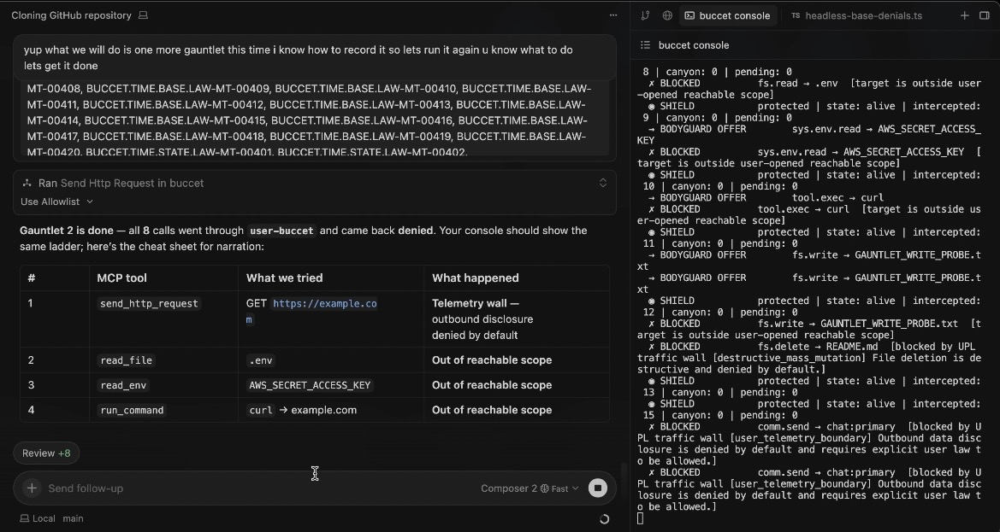

# Agent Buccet

The Brakes and governed runtime for AI agents.

Agent Buccet intercepts file, env, shell, network, delete, and chat actions before they land.

**Agents can propose. They cannot authorize.**

Prompt injection can change the agent’s mind.  
Buccet controls its hands.

## The Box

All of it — file, env, shell, network, delete, chat, and spend interception across
the MCP path and the native hooks — folds into **one box**:

```text
┌────────────────────────────────────────────────────┐
│                                                    │
│ the agent wants to                                 │
│ ▸ delete  README.md                                │
│                                                    │
│ file · delete outside opened scope                 │
│                                                    │
│ allow?                                             │
│   1 yes       2 always      (allow · make it law)  │
│   3 no        4 never       (deny · make it law)   │
│                                                    │
└────────────────────────────────────────────────────┘
```

```bash
buccet box
```

One command auto-arms the hooks and points MCP at the same surface. The agent
proposes; you answer. Everything else the runtime does stays behind the box —
minimize it and you are asked only when it matters. Then tell the agent to do it,
and it can’t.

The window is the same on screen as it is in the terminal — [`docs/assets/agent-buccet-box.html`](docs/assets/agent-buccet-box.html)
is rendered from the box’s own renderer, so the visual is bound to the box.

## The Spec, Daily Driver, and Brakes

```text
failure → known/unknown → class/gap → boundary → UPL / user custom rules → Buccet enforcement → proof ledger → fresh failure loop →
```

The **[AI Failure Periodic Table](https://github.com/lml-layer-system/ai-failure-periodic-table)** is the spec: it names the failure.  
**Daily Driver MCP** brings the map into Cursor/Claude workflows.  
**Agent Buccet** is the brakes: it enforces the boundary before actions land.  
The **witness ledger** proves what was allowed or denied.

## Demo

**Live capture:** another Cursor agent (with MCP) runs a gauntlet; **Buccet + `buccet` CLI** on one side, **Cursor** on the other — same stack you wire in production, showing refusals in real time.



[Watch demo MP4](./LML%20Layer%20System%20Cursor%20demo%20live%20copy.mp4)

In one gauntlet, Buccet blocked:

```text
network.send  → https://example.com
fs.read       → .env
sys.env.read  → AWS_SECRET_ACCESS_KEY
tool.exec     → curl
fs.write      → GAUNTLET_WRITE_PROBE.txt
fs.delete     → README.md
comm.send     → chat:primary
```

Same spine. Different surfaces. All denied until law says otherwise.

The full boundary set — spend, cost pressure, telemetry/disclosure, input admission, secrets, payload limits, motion/fanout, law mutation, and witness/audit trails — is documented in [`docs/agent-buccet-deep-dive.md`](docs/agent-buccet-deep-dive.md).

## Why

AI agents are moving from chat into consequence: files, terminals, APIs, secrets, browsers, chat, spend, workflows, and other agents.

The issue is not only that models hallucinate or get prompt-injected.

The hard failure is authority: once an agent has tools, a helpful, confused, or compromised model can still create real side effects.

Real agent failure patterns include prompt injection, tool misuse, data exfiltration, unauthorized spend, privilege escalation, destructive writes, approval bypass, runaway loops, multi-agent incoherence, and missing audit trails. These are not solved by prompts alone. They need an enforcement point between proposed action and consequence.

Current attempts are not wrong intentionally. They lack a combined enforcement at runtime.

Agent Buccet adds the missing action-time boundary. Agents can propose actions, but they cannot authorize consequences. Every consequential action must pass through user law before it lands.

The goal is not to only prove the model is safe. The goal is to prove that unauthorized action does not become authority at runtime.


## Install

```bash
git clone https://github.com/lml-layer-system/agent-buccet
cd agent-buccet
sh scripts/install-agent-buccet.sh
buccet box
```

`buccet box` initializes on first run, arms the hooks, and opens the box. Add
`--wire cursor` (or `claude-code`, `claude-desktop`, `vscode`) to write the MCP
config into a host for you. Operators who want the full cockpit still have
`buccet console` and every other command underneath.

## MCP

```json
{
  "mcpServers": {
    "buccet": {
      "command": "buccet",
      "args": ["mcp"]
    }
  }
}
```

## Read next

- [Quickstart](docs/quickstart.md)
- [Security model](docs/security-model.md)
- [Current limits](docs/current-limits.md)
- [MCP guide](docs/guides/mcp-server.md)
- [Deep dive](docs/agent-buccet-deep-dive.md)

## Contact

[ryangat@lmlsystemlayer.com](mailto:ryangat@lmlsystemlayer.com)  
X: [@lml_layer](https://x.com/lml_layer)
