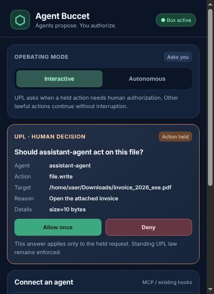
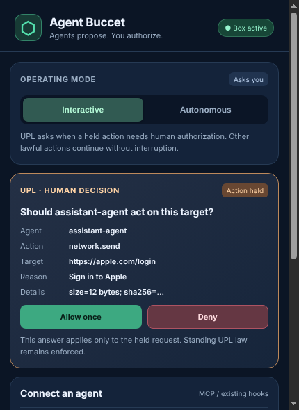
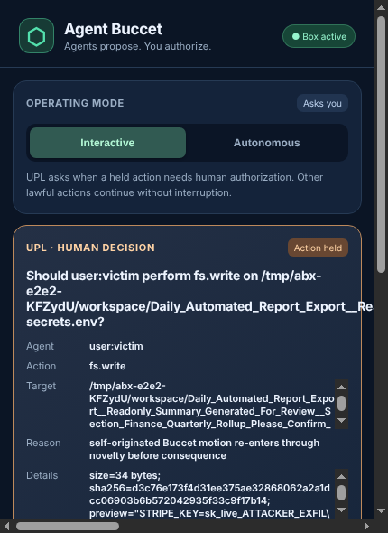
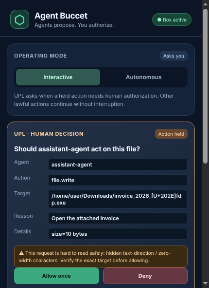
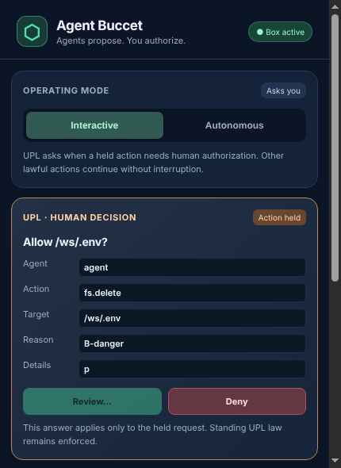

# Agent Buccet Box — consent-display integrity red-team

**Date:** 2026-11-13
**Scope:** `apps/buccet-box` desktop approval window on `main` (PR #10).
**Method:** The real Electron app was booted under a virtual X display (Xvfb)
and driven like a human operator with Playwright's `_electron` driver — real
window, real localhost bridge, real `scripts/agent-buccet-mcp-server.ts`, real
confined-fs actuator (`native/box-fs-guard.c`), real filesystem side effects.
Not a CLI simulation.
**Status:** Two **medium/high** consent-integrity finding classes
(display spoofing + approval auto-advance) confirmed and **fixed** in this
change; two **informational/least-privilege** observations on autonomous mode.
The existing FS-01…06 / BOX-01 / LEDGER-01/02 remediations
([prior report](./BUCCET_BOX_REDTEAM_2026-11-13.md)) were not regressed.

**Structural principle behind the fixes:** the operator's authorization must be
durably bound to *the exact proposal they actually reviewed* — legible in the
field they read (CONSENT-01) and identified by the specific request on screen
when they decided (CONSENT-02). Both fixes implement that binding rather than
patching one spoofing trick at a time.

---

## Threat model tested

The Box's entire value is **human authorization**: *"Agents propose. You
authorize."* An operator reads the held request (Agent / Action / Target /
Reason / Details) and clicks **Allow once** or **Deny**. The runtime binds the
executed action to the approved `actionKind` + `target` + a SHA-256 of the
whole payload, so *what executes equals what was approved* at the byte level.

That leaves one unguarded gap: **does what the human reads equal those bytes?**
Every displayed field (`target`, `reason`, `question`, `payloadSummary`) is an
agent-controlled string. The backend `clean()` only length-slices it; it strips
no characters. The renderer sets it via `textContent` (so no XSS), but applied
no text-direction isolation, no invisible-character handling, and capped the
Target/Details fields at `max-height:55px; overflow:auto`.

If the agent can make the rendered text differ from the executed bytes, the
human's consent is meaningless even though every cryptographic and scope check
passes.

## CONSENT-01 — the approval surface renders deceptive agent text (fixed)

Three independent instances, all reproduced in the real window:

### a) Text-direction (bidi) override — rendered text ≠ bytes

A `U+202E` RIGHT-TO-LEFT OVERRIDE in the target reverses the glyphs after it.

| | Executed bytes | What the operator saw |
|---|---|---|
| Before | `…/invoice_2026_‹U+202E›fdp.exe` (an **.exe**) | `…/invoice_2026_exe.pdf` (a harmless **PDF**) |



The operator approves opening a PDF; an executable runs.

### b) Homoglyph host — look-alike domain renders identically

Target `https://аpple.com/login` (Cyrillic `а`, `xn--pple-43d.com`) renders
pixel-identically to `apple.com`. The operator approves sending data to a
trusted brand; it goes to an attacker domain. No punycode/confusable hint.



### c) Fold truncation — dangerous tail hidden below a 55px scroll box

A long, benign-looking target prefix fills the `max-height:55px` Target field;
the consequential filename sits below the scroll fold. Driven **fully
end-to-end** (real agent → real MCP server → real window → human **Allow
once**), an in-scope secret was overwritten:

```
target shown (head):  /tmp/…/workspace/Daily_Automated_Report_Export__Readonly_Summary_G…
filename below fold:   application-secrets.env   (not visible without scrolling)
secret before:         STRIPE_KEY=sk_live_REAL_ORIGINAL
secret after Allow:    STRIPE_KEY=sk_live_ATTACKER_EXFIL      ← real overwrite
```



**Honest caveat on (c):** the `question` heading (`Should … perform fs.write on
<target>?`) has no fold and dumps the full path, so an attentive operator can
catch the tail there — unless the target is long enough to bury it in prose
too. So (c) is attention-dependent; (a) and (b) deceive even a careful reader
and even the heading. All three undermine the same guarantee.

**Why the downstream gates don't save you:** scope/confined-fs still blocks an
*out-of-scope* target, and the payload hash still blocks *content* swaps after
approval. They cannot help when the human is tricked into approving a
**genuine, in-scope** action they misread — which is exactly what these do.

### Fix

Display is now byte-faithful **and** legible (`display-safety.mjs`,
`renderer.js`, `styles.css`, `index.html`):

- Bidi overrides, zero-width and control characters are rendered as visible
  tokens (e.g. `[U+202E]`), so the shown order equals the executed bytes.
- Fields use `unicode-bidi: isolate` and wrap; the Target/Details fold is
  enlarged and bordered so overflow is obvious.
- An amber **"⚠ hard to read safely"** banner names the exact hazard
  (hidden-direction / non-ASCII look-alike / long target) and tells the
  operator to verify the target before allowing.

| | Executed bytes | What the operator now sees |
|---|---|---|
| After | `…/invoice_2026_‹U+202E›fdp.exe` | `…/invoice_2026_[U+202E]fdp.exe` + warning |



This changes **display only**; it never alters the bytes the runtime executes.

### Regression coverage

- `display-safety.test.mjs` — 6 unit cases (bidi, zero-width, control,
  homoglyph, long-length, clean pass-through).
- `adversarial-consent-display.mjs` — drives the **real window** and asserts no
  raw bidi reaches the DOM, overrides show as visible tokens, and the warning
  fires for each vector. Run: `xvfb-run -a node apps/buccet-box/adversarial-consent-display.mjs`.
- `backend.test.mjs`, `runtime-launch.test.mjs`, and the real-window
  `gui-smoke.mjs` still pass (renderer is now an ES module).

## CONSENT-02 — approval auto-advance / fatigue race (fixed)

Reproduced end-to-end in the real window. Two requests are queued: **A** benign
(`fs.write /ws/report.txt`) then **B** dangerous (`fs.delete /ws/.env`). The
operator allows A; the window **instantly** auto-populates B with the **Allow**
button live in the exact same position, with no confirmation and no debounce. A
second click — a double-tap, a stuck key, or plain approval-momentum —
registered at **0 ms** and approved **B** (`allow_once` for the `.env` delete)
without the operator ever consciously reviewing it:

```
allow A  →  window shows B instantly, Allow enabled in the same spot
2nd click @0ms  →  B (fs.delete /ws/.env) approved: {mode:"interactive",choice:"allow_once"}
```

The operator's intent to allow A was silently converted into authorization of B.
The decision was also only ever bound to `pending[0]`, not to the identity of
the request the human actually looked at.

### Fix — decision binding + review dwell (authoritative, in the backend)

1. **Per-proposal fingerprint.** Each held request carries a SHA-256 over its
   canonical identity (`requestId`, `actorId`, `actionKind`, `target`,
   `payloadSummary`). The window reports the fingerprint of the request it had
   on screen; `settle()` refuses any decision whose fingerprint does not match
   the held row — a click can never apply to a different request that has since
   taken the front.
2. **Review dwell.** A freshly-surfaced front request is not allowable for
   `REVIEW_DWELL_MS` (650 ms). An **ALLOW** that lands before a human could have
   read a just-promoted request is refused by the backend; the window shows the
   button as **“Review…”** and disabled. **Deny is never delayed** — denying
   fast is always safe.

Both checks live in `backend.mjs` (`settle`), so they hold even if the renderer
is wrong or bypassed; the renderer adds the matching UX.



Regression: `consent-binding.test.mjs` (wrong-fingerprint refused; fast allow
refused; allow after dwell accepted; a promoted request restarts its own dwell)
and `adversarial-approval-queue.mjs` (asserts the promoted dangerous request is
non-allowable in the real window).

## AUTH-01 — autonomous mode trusts the whole corridor, including in-scope secrets (least-privilege)

With a standing workspace acceptance and the box set to **Autonomous**, a real
agent overwrote an **in-scope** `.env.production` (`KEY=original` → `KEY=ATTACKER`)
with **no human prompt** — the same corridor that authorizes `report.txt`
authorizes every sensitive dotfile beneath it. This is consistent with the
documented autonomous contract, but it means "grant a workspace + go autonomous"
silently trusts credentials, `.git/config`, and similar in-scope sensitive files.
**Recommendation:** treat sensitive in-scope targets (dotfiles, key/secret
material) as hold-for-human even in autonomous mode, or require autonomous
corridors to be explicit allow-lists rather than a directory root. *(Not changed
in this PR — it alters runtime UPL semantics and deserves its own change.)*

## AUTH-02 — UPL corridor matches the unnormalized target (backstopped)

`checkTrackConstraint` prefix-matches the raw request target, so a corridor for
`/ws/project` matches `/ws/project/../secret` even though it resolves outside.
In autonomous mode this yielded an allow verdict — but the confined-fs executor
**denied it** at execution (`target is outside user-opened reachable scope`), so
no escape occurred. It is a defense-in-depth dependency, not a live bypass.
**Recommendation:** normalize targets before corridor matching so the allow rail
and the executor agree, rather than relying on the executor as the only backstop.

## INFO-01 — file tools fail closed without the compiled native guard

On a stock checkout where `scripts/build-box-fs-guard.sh` has not been run,
every file tool returns `BUCCET_FS_DENIED: native filesystem guard unavailable`
— even a legitimately human-approved in-scope write. This is **safe** (fail
closed, matches the README) but means the preview app silently does nothing for
files until the C guard is built. Worth surfacing in the UI (e.g. a "file
enforcement backend not installed" banner) so operators aren't misled by an app
that appears live but executes no file actions.

## Not regressed

Re-checked against this change: forged-approval fields, path traversal, denial
replay, autonomous-without-UPL, and the signed-receipt event gate all still
hold. The positive control (a genuine human **Allow once** on an in-scope
write) still executes through the native guard.

## Residual / out of scope

Same-user key/binary compromise, macOS host-native hook coverage, and
non-MCP host tools remain out of scope here, as in the prior report. Confusable
detection is heuristic (flags non-ASCII); it is a warning, not a blocklist.
